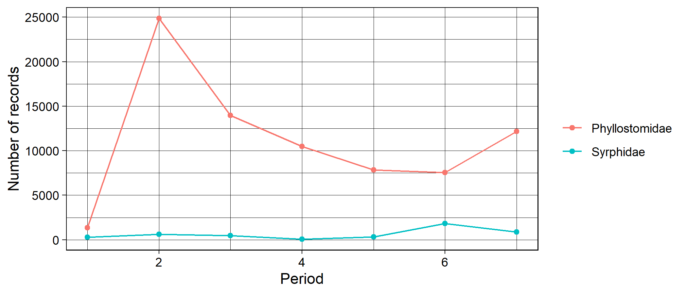
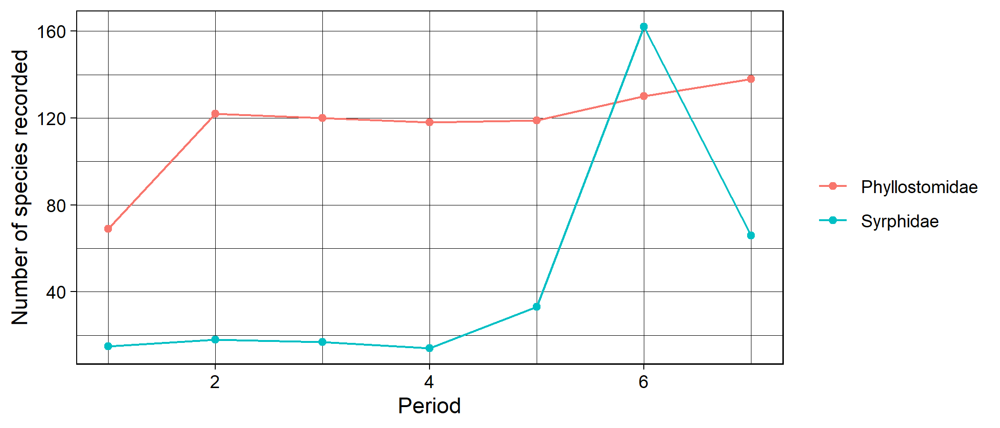
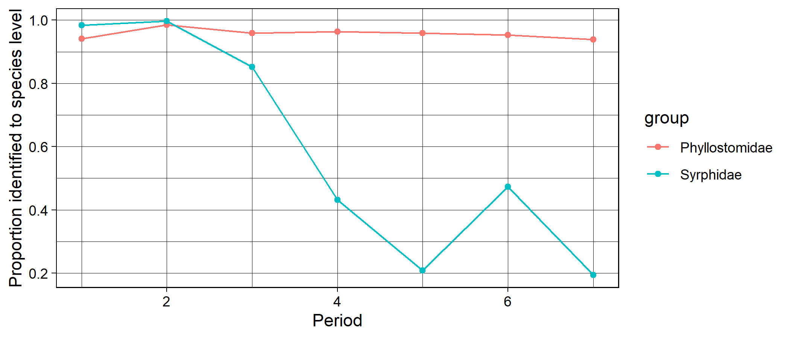
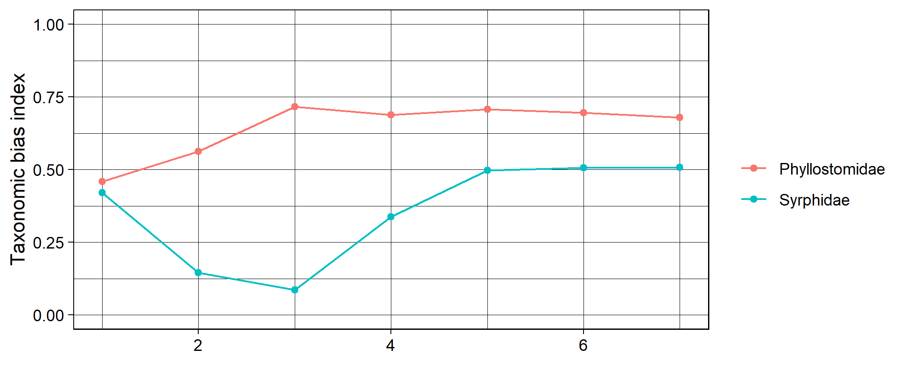
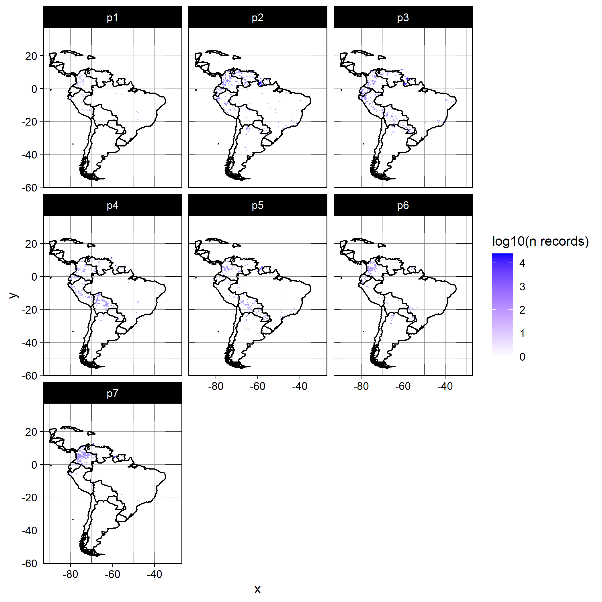
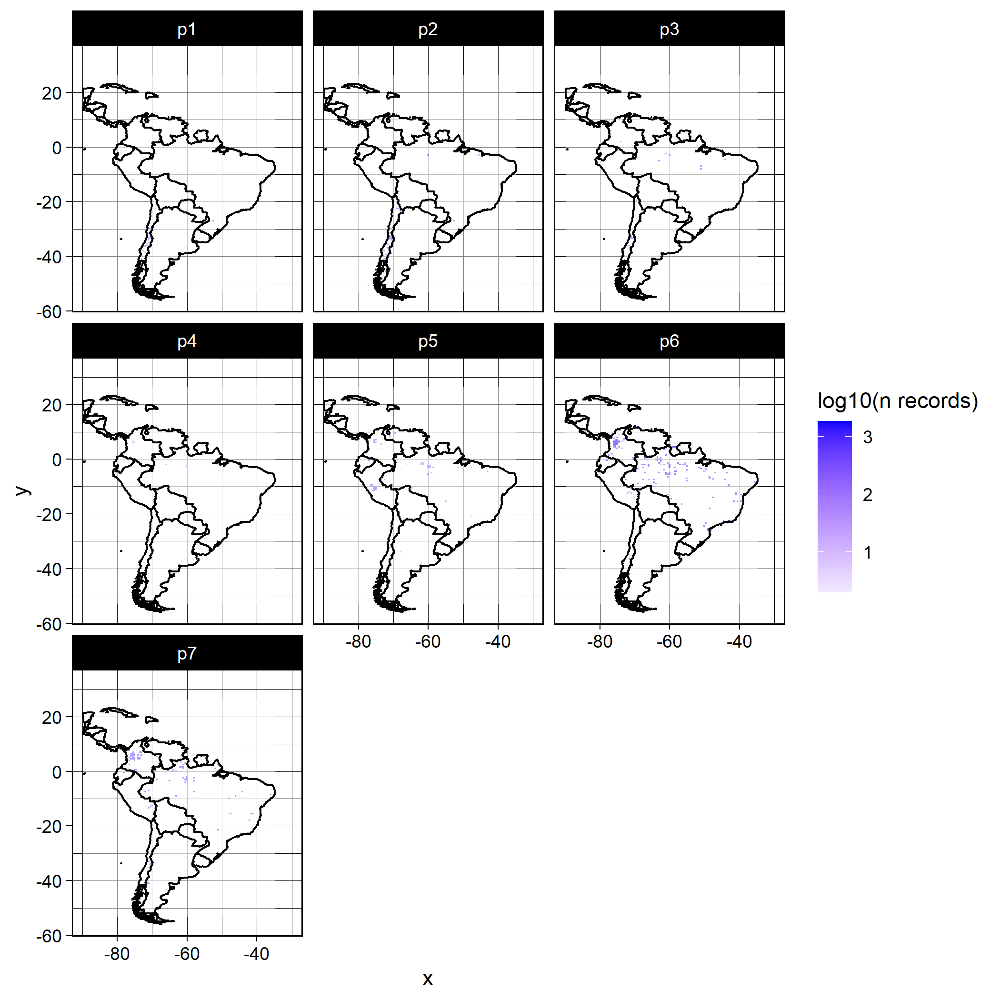
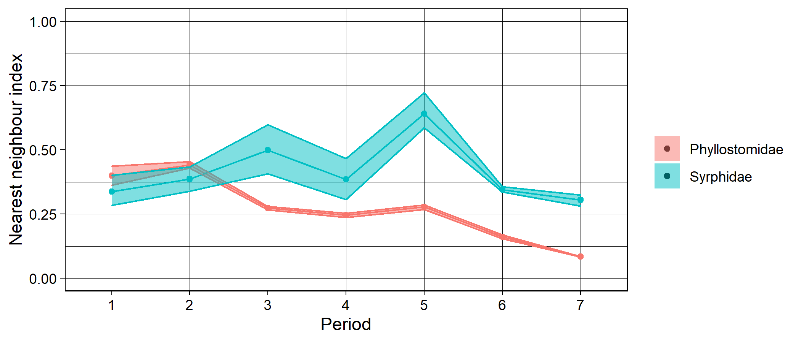
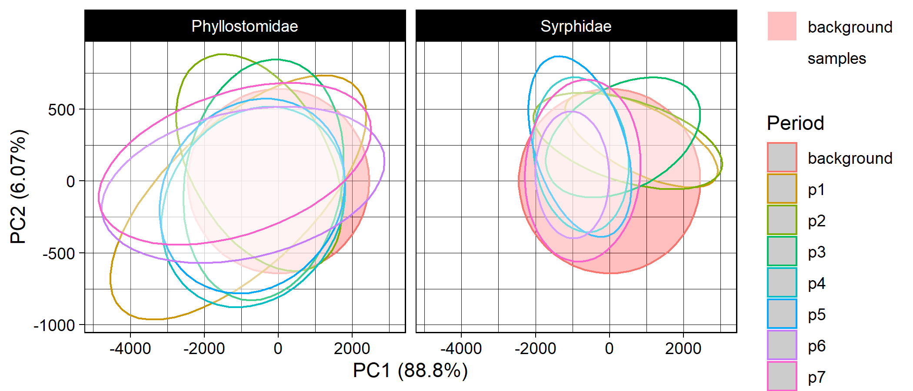

> **Historical, static example.** This case study preserves the original
> South American analysis and its pre-rendered figures. Its code is not executed
> when the vignette is built because the cleaned occurrence table, mask, country
> boundary, and environmental rasters are not distributed with the package. The
> occurrence download is available from
> [GBIF](https://doi.org/10.15468/dl.wqz6z3); the environmental source is
> [WorldClim](https://www.worldclim.org/). Paths below are placeholders that
> users must replace with their own compatible files.

```r
library(occAssess)
```

# What does occAssess do? 

occAssess enables quick and easy screening of species occurrence data for common forms of bias. 

## How does it work? 

The package comprises discrete functions for different aspects of occurrence
data quality. Most functions use an occurrence table, a list of periods, and
column names identifying required fields. Return structures vary by function;
the current help pages document their named components.

## A worked example 

In this document I demonstrate the utility of occAssess by applying it to data on flower-visiting taxa occurrences in South America over the period 1950 to 2019. The data were extracted from GBIF and can be accessed at https://doi.org/10.15468/dl.wqz6z3. 

### Inputs

#### Occurrence data

The occurrence functions generally require fields for species name, x and y
coordinates, year, spatial uncertainty, and an identifier used to split records
into groups. Column names may differ when the function accepts column-name
arguments. Coordinate, uncertainty, mask, and resolution units must be mutually
consistent.


```r

spDat <- read.csv("<path-to-downloaded-and-cleaned-GBIF-data.csv>")

str(spDat)
#> 'data.frame':	82710 obs. of  6 variables:
#>  $ species           : chr  "Artibeus lituratus" "Carollia perspicillata" "Sturnira parvidens" "Sturnira tildae" ...
#>  $ x                 : num  -75.1 -75.1 -67.8 -61.4 -72 ...
#>  $ y                 : num  5.27 5.28 10.4 5.98 7.32 ...
#>  $ year              : int  2019 2019 1960 1966 1968 1968 1968 1986 1981 1967 ...
#>  $ spatialUncertainty: num  NA NA NA NA NA NA NA NA NA NA ...
#>  $ identifier        : chr  "Phyllostomidae" "Phyllostomidae" "Phyllostomidae" "Phyllostomidae" ...
```

#### Periods

In addition to your occurrence data, you must also provide a number of periods into which your data will be split (thi can be one period covering e.g. your whole study extent). In this example I will split the data into decades over the period 1950 to 2019. Periods are defined as follows:


```r

periods <- list(1950:1959, 1960:1969, 1970:1979, 1980:1989, 1990:1999, 2000:2009, 2010:2019)
```

### Functions

All of the functions in occAssess require two common arguments (in addition to the arguments that specify which column matches which field): dat and periods (outlined above). I will run through each function in the following, indicating where additional arguments are required. Generally, the functions in occAssess return a list with two elements: one being a ggplot2 object, with a separate panel or group for each level of identifier; and a second with the data underpinning the plot.

#### assessRecordNumber

The first function is `assessRecordNumber()`, which counts records per period
and identifier.


```r

nRec <- assessRecordNumber(dat = spDat,
                           periods = periods,
                           species = "species",
                           x = "x",
                           y = "y",
                           year = "year", 
                           spatialUncertainty = "spatialUncertainty",
                           identifier = "identifier",
                           normalize = FALSE)

str(nRec$data)
#> 'data.frame':	14 obs. of  3 variables:
#>  $ val   : int  1363 24855 13971 10499 7843 7546 12183 302 613 461 ...
#>  $ group : chr  "Phyllostomidae" "Phyllostomidae" "Phyllostomidae" "Phyllostomidae" ...
#>  $ Period: int  1 2 3 4 5 6 7 1 2 3 ...

nRec$plot
```



This function enables researchers to quickly establish how the number of records has changed over time. Note the argument "normalize" which, if TRUE, will rescale the counts for each level of identifier to enable comparisons where they are very different.

#### assessSpeciesNumber 

In addition to the number of records, you may wish to know how the number of species (taxonomic coverage) in your dataset changes over time. For this you can use the function assessSpeciesNumber:


```r

nSpec <- assessSpeciesNumber(dat = spDat,
                             periods = periods,
                             species = "species",
                             x = "x",
                             y = "y",
                             year = "year", 
                             spatialUncertainty = "spatialUncertainty",
                             identifier = "identifier",
                             normalize = FALSE)

str(nSpec$data)
#> 'data.frame':	14 obs. of  3 variables:
#>  $ val   : int  69 122 120 118 119 130 138 15 18 17 ...
#>  $ group : chr  "Phyllostomidae" "Phyllostomidae" "Phyllostomidae" "Phyllostomidae" ...
#>  $ Period: int  1 2 3 4 5 6 7 1 2 3 ...

nSpec$plot
```



#### assessSpeciesID 

It has been speculated that apparent changes in taxonomic coverage could reflect
changes in taxonomic expertise. `assessSpeciesID()` reports the count or
proportion of records whose species field is non-missing:


```r

propID <- assessSpeciesID(dat = spDat,
                           periods = periods,
                           type = "proportion",
                           species = "species",
                           x = "x",
                           y = "y",
                           year = "year", 
                           spatialUncertainty = "spatialUncertainty",
                           identifier = "identifier")

str(propID$data)
#> 'data.frame':	14 obs. of  3 variables:
#>  $ prop  : num  0.941 0.986 0.959 0.963 0.959 ...
#>  $ group : chr  "Phyllostomidae" "Phyllostomidae" "Phyllostomidae" "Phyllostomidae" ...
#>  $ Period: int  1 2 3 4 5 6 7 1 2 3 ...

propID$plot
```



The argument "type" can take the values proportion (proportion of records identified to species level) or count (number of records identified to species level). 

#### assessRarityBias

`assessRarityBias()` measures association between recorded range size (occupied
grid cells) and record count. With `metric = "r2"`, it returns the coefficient
of determination from a period-specific regression; `metric = "cor"` returns
Pearson correlation. Here `prevPerPeriod = FALSE` calculates occupied cells
for each species across all selected periods.


```r

taxBias <- assessRarityBias(dat = spDat,
                            periods = periods,
                            res = 0.5,
                            prevPerPeriod = FALSE,
                            species = "species",
                            x = "x",
                            y = "y",
                            year = "year", 
                            spatialUncertainty = "spatialUncertainty",
                            identifier = "identifier")
#> Warning in assessRarityBias(dat = spDat, periods = periods, res = 0.5, prevPerPeriod = FALSE, : Removing 4843 records
#> because they are do not identified to species level.

str(taxBias$data)
#> 'data.frame':	14 obs. of  3 variables:
#>  $ period: int  1 2 3 4 5 6 7 1 2 3 ...
#>  $ id    : chr  "Phyllostomidae" "Phyllostomidae" "Phyllostomidae" "Phyllostomidae" ...
#>  $ index : num  0.459 0.562 0.716 0.688 0.707 ...

taxBias$plot +ggplot2::ylim(c(0,1))
```



#### assessSpatialCov 

The function assessSpatialCov grids your data at a specified spatial resolution then maps it in geographic space:


```r

maps <- assessSpatialCov(dat = spDat,
                         periods = periods,
                         res = 0.5,
                         logCount = TRUE,
                         countries = c("Brazil", "Argentina", "Chile", "Colombia", "Ecuador", "Bolivia", "Uruguay", 
                         "Venezuela",  "Paraguay", "Peru", "Suriname", "Mexico", "Panama", "Costa Rica", "Honduras",
                         "Nicaragua", "Belize", "El Salvador", "Guatemala", "Cuba", "Dominican Republic"),
                         species = "species",
                         x = "x",
                         y = "y",
                         year = "year", 
                         spatialUncertainty = "spatialUncertainty",
                         identifier = "identifier")

maps[[1]] + ggplot2::xlim(c(-90, -30)) # Phyllostomidae
#> Warning: Removed 47859 rows containing missing values (geom_tile).
```



```r

maps[[2]] + ggplot2::xlim(c(-90, -30)) # Syrphidae
#> Warning: Removed 47859 rows containing missing values (geom_tile).
```



`res` uses the coordinate units of the occurrence data (for example, metres
in a projected CRS or decimal degrees in longitude/latitude).
`logCount = TRUE` applies a base-10 transformation to density displays and
returned density rasters; sampled-period and overlap calculations always use
untransformed record presence. `countries` adds boundaries from
`ggplot2::map_data("world")` and is appropriate only for WGS84
longitude/latitude. Boundaries are optional.

#### assessSpatialBias

`assessSpatialBias()` compares the empirical mean nearest-neighbour distance
with random samples drawn within a raster mask. Values below one indicate
greater clustering than the random samples; values above one indicate greater
dispersion. The mask must share the occurrence coordinates' CRS and be numeric
inside the sampling domain and `NA` outside it.


```r

mask <- raster::raster("<path-to-South-America-mask.asc>")

mask
#> class      : RasterLayer 
#> dimensions : 410, 279, 114390  (nrow, ncol, ncell)
#> resolution : 0.1666667, 0.1666667  (x, y)
#> extent     : -81.33333, -34.83333, -55.83333, 12.5  (xmin, xmax, ymin, ymax)
#> crs        : NA 
#> source     : climSA.asc 
#> names      : climSA
```


```r

spatBias <- assessSpatialBias(dat = spDat,
                              periods = periods,
                              mask = mask,
                              nSamps = 10,
                              degrade = TRUE,
                              species = "species",
                              x = "x",
                              y = "y",
                              year = "year", 
                              spatialUncertainty = "spatialUncertainty",
                              identifier = "identifier")
#> Registered S3 method overwritten by 'spatstat.geom':
#>   method     from
#>   print.boxx cli
#> Warning in FUN(X[[i]], ...): Fewer than 100 records in period 1 for Syrphidae . View this result with caution.
#> Warning in FUN(X[[i]], ...): Fewer than 100 records in period 2 for Syrphidae . View this result with caution.
#> Warning in FUN(X[[i]], ...): Fewer than 100 records in period 3 for Syrphidae . View this result with caution.
#> Warning in FUN(X[[i]], ...): Fewer than 100 records in period 4 for Syrphidae . View this result with caution.
#> Warning in FUN(X[[i]], ...): Fewer than 100 records in period 5 for Syrphidae . View this result with caution.

str(spatBias$data)
#> 'data.frame':	14 obs. of  5 variables:
#>  $ mean      : num  0.397 0.437 0.278 0.247 0.277 ...
#>  $ upper     : num  0.424 0.449 0.288 0.257 0.289 ...
#>  $ lower     : num  0.377 0.416 0.272 0.234 0.266 ...
#>  $ Period    : chr  "1" "2" "3" "4" ...
#>  $ identifier: chr  "Phyllostomidae" "Phyllostomidae" "Phyllostomidae" "Phyllostomidae" ...

spatBias$plot + ggplot2::ylim(c(0,1))
```



The argument nSamps indicates how many random distributions should be drawn, and the argument degrade = TRUE indicates that any duplicated coordinates within a time period and for a given level of identifier are removed. The shaded regions on the plot indicate the 5th and 95th percentiles of the nearest neighbour index calculated over nSamps random samples. 

#### assessEnvBias 

Spatial bias does not necessarily imply environmental bias.
`assessEnvBias()` uses PCA to display retained occurrence records in
environmental space. `envDat` must have one row per occurrence, in the same
order, and background data must use the same environmental columns. The
historical example used WorldClim bioclimatic layers:


```r
clim <- raster::stack(list.files("<path-to-WorldClim-bioclim-layers>",
                           full.names = T)) # my local version (19 raster layers)

# delineate south america in the climate data 

shp <- raster::shapefile("<path-to-South-America-boundary.shp>")
#> Warning in OGRSpatialRef(dsn, layer, morphFromESRI = morphFromESRI, dumpSRS = dumpSRS, : Discarded ellps WGS 84 in Proj4
#> definition: +proj=merc +a=6378137 +b=6378137 +lat_ts=0 +lon_0=0 +x_0=0 +y_0=0 +k=1 +units=m +nadgrids=@null +wktext
#> +no_defs
#> Warning in OGRSpatialRef(dsn, layer, morphFromESRI = morphFromESRI, dumpSRS = dumpSRS, : Discarded datum WGS_1984 in
#> Proj4 definition: +proj=merc +a=6378137 +b=6378137 +lat_ts=0 +lon_0=0 +x_0=0 +y_0=0 +k=1 +units=m +nadgrids=@null +wktext
#> +no_defs
#> Warning in showSRID(wkt2, "PROJ"): Discarded ellps WGS 84 in Proj4 definition: +proj=merc +a=6378137 +b=6378137 +lat_ts=0
#> +lon_0=0 +x_0=0 +y_0=0 +k=1 +units=m +nadgrids=@null +wktext +no_defs +type=crs
#> Warning in showSRID(wkt2, "PROJ"): Discarded datum World Geodetic System 1984 in Proj4 definition

shp <- sp::spTransform(shp, raster::crs(clim))

clim <- raster::crop(clim, raster::extent(shp))

clim <- raster::mask(clim, shp)

## exract climate data at coordinates of occurrence data 

envDat <- raster::extract(clim, spDat[, c("x", "y")])

## extract background environmental data 

backgroundEnvDat <- raster::sampleRandom(clim, size = 10000,
                       xy = F)
```
assessEnvBias conducts a principal component analysis on your environmental data, then maps your occurrence data in 2d environmental space. If backgroundEnvDat is supplied, then the PCA is conducted on this sample, and the occurrence data are projected on to this plane. Otherwise, the PCA is conducted on the environmental data corresponding to the occurrence data and there is no reference to background environmental space.


```r

envBias <- assessEnvBias(dat = spDat,
                         species = "species",
                         x = "x",
                         y = "y",
                         year = "year", 
                         spatialUncertainty = "spatialUncertainty",
                         identifier = "identifier",
                         envDat = envDat,
                         backgroundEnvDat = backgroundEnvDat,
                         xPC = 1,
                         yPC = 2,
                         periods = periods) # xPC and yPC indicate which principal components to set as the x and y axes,respectively


envBias$plot
```



