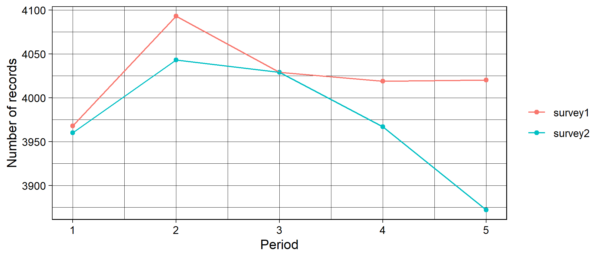
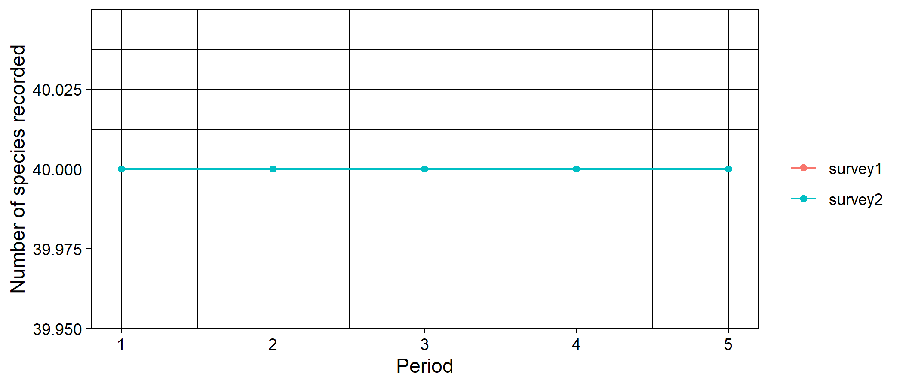
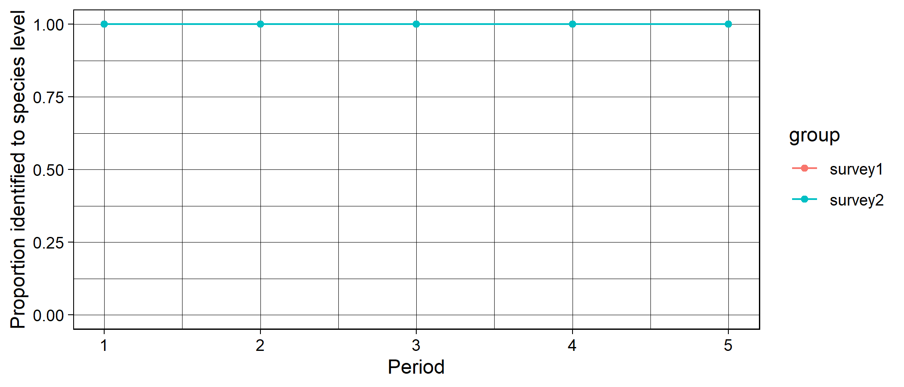
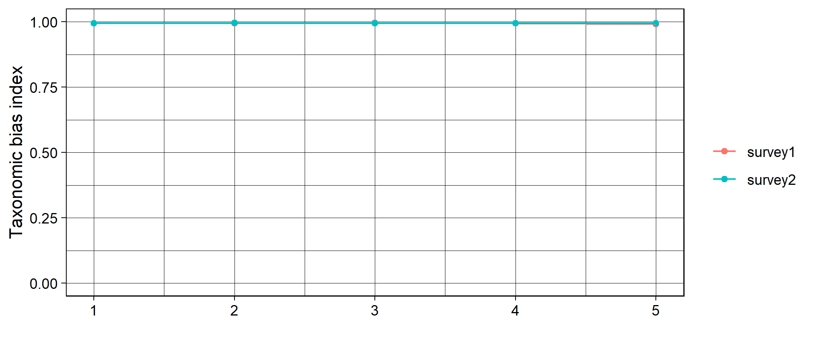
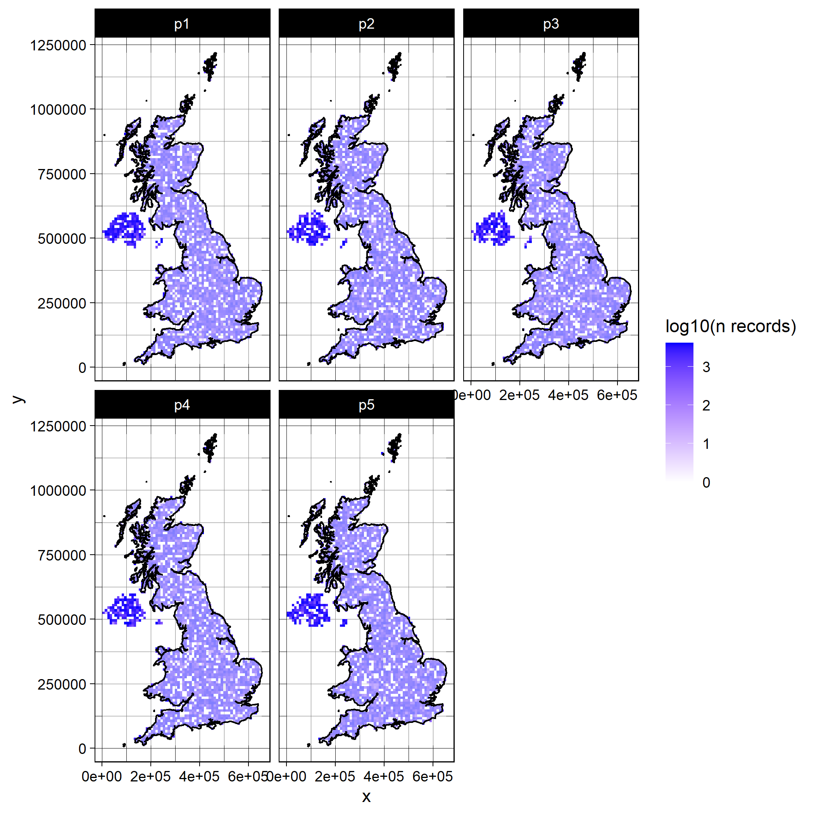
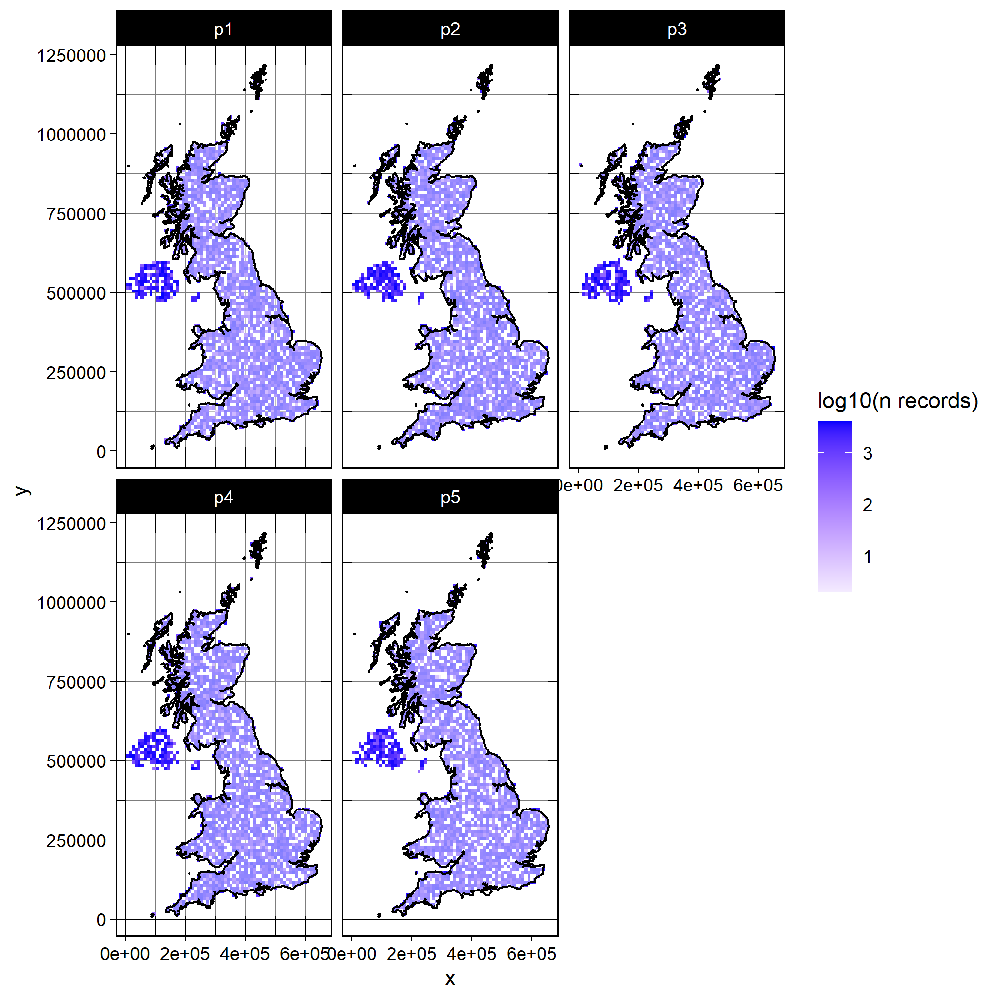
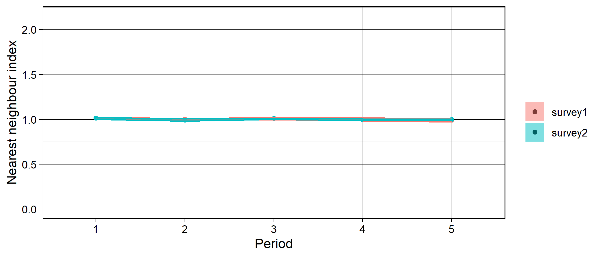
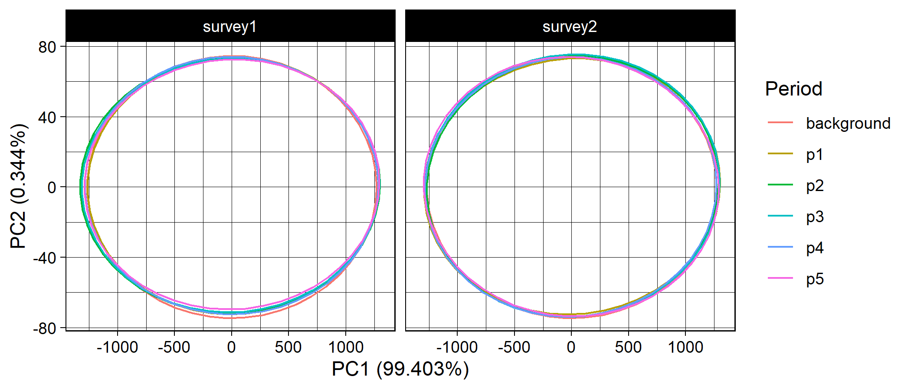

> **Historical, static example.** The occurrence table and environmental tables
> used below are bundled with `occAssess`, and most code can be copied into an
> R session after loading the package. The original mapping sections are kept
> for scientific context but are not directly reproducible: they used the
> private `BRCmap` package and an external raster mask that are not distributed
> here. Pre-rendered figures are retained, and no code in this vignette is
> executed during package checks. See the fully reproducible vignette for an
> end-to-end executable workflow.

```r
library(occAssess)
```

### Introduction

This vignette preserves a worked example based on simulated, approximately
random UK occurrences.

### Occurrence data 

The dataset approximates random distributions in space and time for forty
species. Record prevalence varies among species, locations are in the UK on a
projected coordinate system, years span 2001 to 2010, and records are assigned
to two simulated surveys in the `identifier` field.


```r

data(random40Species)

spDat <- random40Species

str(spDat)
#> 'data.frame':	40000 obs. of  6 variables:
#>  $ species           : Factor w/ 40 levels "species1","species10",..: 14 19 8 28 5 33 12 27 36 12 ...
#>  $ x                 : num  213500 289500 369500 223500 374500 ...
#>  $ y                 : num  797500 745500 537500 591500 520500 ...
#>  $ year              : int  2009 2004 2006 2010 2009 2004 2004 2004 2010 2001 ...
#>  $ spatialUncertainty: num  9802 3506 15310 9810 7189 ...
#>  $ identifier        : Factor w/ 2 levels "survey1","survey2": 2 2 1 1 1 1 1 1 1 1 ...
```

### Periods

In this example, we will specify five periods over 2001 to 2010


```r

periods <- list(2001:2002, 2003:2004, 2005:2006, 2007:2008, 2009:2010)
```

### Functions

All of the functions in occAssess require two common arguments: dat and periods (outlined above). I will run through each function in the following, indicating where additional arguments are required. Generally, the functions in occAssess return a list with two elements: one being a ggplot2 object, with a separate panel or feature for each level of identifier; and a second with the data underpinning the plot.

#### assessRecordNumber

`assessRecordNumber()` counts records per period and identifier.


```r

nRec <- assessRecordNumber(dat = spDat,
                           periods = periods,
                           species = "species",
                           x = "x",
                           y = "y",
                           year = "year", 
                           spatialUncertainty = "spatialUncertainty",
                           identifier = "identifier")

str(nRec$data)
#> 'data.frame':	10 obs. of  3 variables:
#>  $ val   : int  3968 4093 4029 4019 4020 3960 4043 4029 3967 3872
#>  $ group : Factor w/ 2 levels "survey1","survey2": 1 1 1 1 1 2 2 2 2 2
#>  $ Period: int  1 2 3 4 5 1 2 3 4 5

nRec$plot
```



This function enables researchers to quickly establish how the number of records has changed over time. 

#### assessSpeciesNumber 

In addition to the number of records, you may wish to know how the number of species (taxonomic coverage) in your dataset changes over time. For this you can use the function assessSpeciesNumber:


```r

nSpec <- assessSpeciesNumber(dat = spDat,
                           periods = periods,
                           species = "species",
                           x = "x",
                           y = "y",
                           year = "year", 
                           spatialUncertainty = "spatialUncertainty",
                           identifier = "identifier")

str(nSpec$data)
#> 'data.frame':	10 obs. of  3 variables:
#>  $ val   : int  40 40 40 40 40 40 40 40 40 40
#>  $ group : Factor w/ 2 levels "survey1","survey2": 1 1 1 1 1 2 2 2 2 2
#>  $ Period: int  1 2 3 4 5 1 2 3 4 5

nSpec$plot
```



#### assessSpeciesID 

`assessSpeciesID()` reports the count or proportion of records whose species
field is non-missing:


```r

propID <- assessSpeciesID(dat = spDat,
                           periods = periods,
                           type = "proportion",
                           species = "species",
                           x = "x",
                           y = "y",
                           year = "year", 
                           spatialUncertainty = "spatialUncertainty",
                           identifier = "identifier")

str(propID$data)
#> 'data.frame':	10 obs. of  3 variables:
#>  $ prop  : num  1 1 1 1 1 1 1 1 1 1
#>  $ group : Factor w/ 2 levels "survey1","survey2": 1 1 1 1 1 2 2 2 2 2
#>  $ Period: int  1 2 3 4 5 1 2 3 4 5

propID$plot + ggplot2::ylim(c(0,1)) ## it is easy to modify the outputs of the functions in occAssess to e.g. change axis ranges
```



The argument "type" can take the values proportion (proportion of records identified to species level) or count (number of records identified to species level). 

#### assessRarityBias

`assessRarityBias()` measures association between recorded range size
(occupied grid cells) and record count. With `metric = "r2"`, it returns the
coefficient of determination from each regression. In this example,
`prevPerPeriod = TRUE` calculates occupied cells separately for every period.


```r

taxBias <- assessRarityBias(dat = spDat,
                            periods = periods,
                            res = 20000,
                            prevPerPeriod = TRUE,
                            species = "species",
                            x = "x",
                            y = "y",
                            year = "year", 
                            spatialUncertainty = "spatialUncertainty",
                            identifier = "identifier")

str(taxBias$data)
#> 'data.frame':	10 obs. of  3 variables:
#>  $ period: int  1 2 3 4 5 1 2 3 4 5
#>  $ id    : chr  "survey1" "survey1" "survey1" "survey1" ...
#>  $ index : num  0.994 0.994 0.995 0.995 0.991 ...

taxBias$plot + ggplot2::ylim(c(0,1))
```



The simulated data contain forty species, so all identifier-period combinations
meet the function's minimum of five species for fitting the association.

#### assessSpatialCov 

The original `assessSpatialCov()` example used an OSGB 36 boundary from the
private `BRCmap` package. That dependency is unavailable, so the following
code is retained only to show the historical setup. To rerun it, provide an
equivalent spatial polygon in the same CRS as `spDat`.


```r

# Historical dependency, not publicly available:
# library(BRCmap)
# data(UK)
# shp <- UK[UK$REGION == "Great Britain", ]

shp <- <user-supplied-OSGB36-boundary>

head(shp)
#> class       : SpatialPolygonsDataFrame 
#> features    : 1 
#> extent      : 7422.81, 655616.6, 7041.804, 1218620  (xmin, xmax, ymin, ymax)
#> crs         : +proj=tmerc +lat_0=49 +lon_0=-2 +k=0.9996012717 +x_0=400000 +y_0=-100000 +datum=OSGB36 +units=m +no_defs +ellps=airy +towgs84=446.448,-125.157,542.060,0.1502,0.2470,0.8421,-20.4894 
#> variables   : 2
#> names       :        REGION, ID 
#> value       : Great Britain,  1

map <- assessSpatialCov(dat = spDat,
                        periods,
                        res = 10000,
                        logCount = TRUE,
                        countries = NULL,
                        shp = shp,
                        species = "species",
                        x = "x",
                        y = "y",
                        year = "year", 
                        spatialUncertainty = "spatialUncertainty",
                        identifier = "identifier")
#> Regions defined for each Polygons
#> Regions defined for each Polygons

map$survey1
```



```r

map$survey2
```



`res` uses the coordinate units of the occurrence data (metres for this
projected example). `logCount = TRUE` applies a base-10 transformation for
display. The `countries` option is appropriate only for WGS84
longitude/latitude; projected data require a compatible polygon through
`shp`. Neither boundary option is required to calculate the gridded result.


#### assessSpatialBias

Even if your data has good spatial coverage, it may be biased; that is to say, it may deviate from a random distribution in space. The function assessSpatialBias provides an index of how far your data deviates from a random distribution. To do this it simulates an equal number of points to your data randomly across your study region. Then, for each time period, it calculates the average nearest neighbour distance across your data points and divides it by the average nearest neighbour distance from the random sample. If the index is lower than one then your data is more clustered than the random sample, and if it is above one it is more dispersed. To delineate your study area, you must provide a mask layer. The mask is a raster object which is has numeric values within your study area, and is NA outside of your study area. Here, I'll use some species distribution model outputs for the UK as a mask layer:


```r

mask <- raster::raster("<path-to-compatible-UK-mask.asc>")

mask
#> class      : RasterLayer 
#> dimensions : 1250, 700, 875000  (nrow, ncol, ncell)
#> resolution : 1000, 1000  (x, y)
#> extent     : 0, 7e+05, 0, 1250000  (xmin, xmax, ymin, ymax)
#> crs        : NA 
#> source     : Mammals.asc 
#> names      : Mammals
```


```r

spatBias <- assessSpatialBias(dat = spDat,
                              periods = periods,
                              mask = mask,
                              nSamps = 10,
                              degrade = TRUE,
                              species = "species",
                              x = "x",
                              y = "y",
                              year = "year", 
                              spatialUncertainty = "spatialUncertainty",
                              identifier = "identifier")

str(spatBias$data)
#> 'data.frame':	10 obs. of  5 variables:
#>  $ mean      : num  1.009 0.999 1.001 1.001 0.99 ...
#>  $ upper     : num  1.03 1.01 1.02 1.01 1 ...
#>  $ lower     : num  0.991 0.988 0.988 0.987 0.979 ...
#>  $ Period    : chr  "1" "2" "3" "4" ...
#>  $ identifier: chr  "survey1" "survey1" "survey1" "survey1" ...

spatBias$plot + ggplot2::ylim(c(0, 2.15)) # ylim set to theoretical range of possible values for the nearest neighbour index
```



The argument nSamps indicates how many random distributions should be drawn, and the argument degrade = TRUE indicates that any duplicated coordinates within a time period and for a given level of identifier are removed. The shaded regions on the plot indicate the 5th and 95th percentiles of the nearest neighbour index calculated over nSamps random samples. 

#### assessEnvBias 

The bundled environmental rows correspond one-for-one, in the same order, with
`random40Species`. The bundled background table uses the same WorldClim
variables at 4,000 UK background locations. Current source data are available
from [WorldClim](https://www.worldclim.org/).


```r

data("random40SpeciesEnvDat") # climate data at locations of simulated occurrence data

data("backgroundEnvDat") # climate data at 4000 random locations

# For other data, project environmental rasters to the occurrence CRS before
# extracting values in exactly the occurrence-row order.
```
assessEnvBias conducts a principal component analysis on your environmental data, then maps your occurrence data in environmental space:


```r

envBias <- assessEnvBias(dat = spDat,
                         periods = periods,
                         envDat = random40SpeciesEnvDat,
                         backgroundEnvDat = backgroundEnvDat,
                         xPC = 1,
                         yPC = 2,
                         species = "species",
                         x = "x",
                         y = "y",
                         year = "year", 
                         spatialUncertainty = "spatialUncertainty",
                         identifier = "identifier")

envBias$plot
```


The arguments yPC and xPC indicate which principal components you would like on the y and x axes, respectively. 
